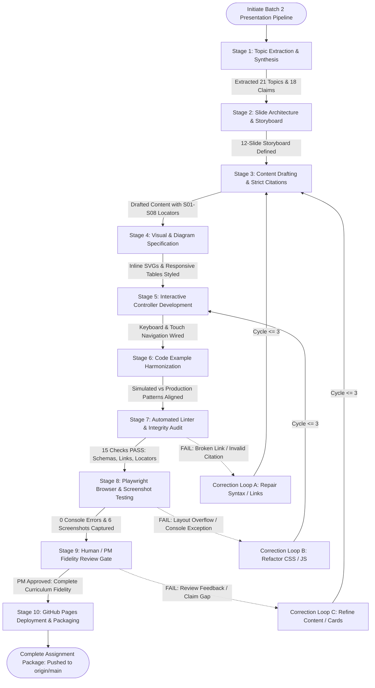

# Workflow Orchestration Graph: 10-Stage Presentation Generation

## 1. Overview and Architectural Philosophy
This document formalizes the orchestration architecture governing the creation, validation, and delivery of the interactive educational HTML presentation for the **AI Agents Learning Wiki**.

Following modern agentic systems engineering, the workflow embodies an intentional hybrid:
1. **The Macro Pipeline is a Directed Acyclic Graph (DAG):** Stages 1 through 10 advance in a deterministic sequence from knowledge extraction to final deployment. Control flow is transparent, reproducible, and verifiable at every milestone.
2. **Local Verification Gates are Cyclic Loops:** Automated linting (Stage 7), browser execution testing (Stage 8), and PM fidelity review (Stage 9) act as strict evaluation checkpoints. If a gate discovers an integrity defect, console error, or citation drift, a **bounded cyclic loop (maximum 3 iterations)** returns the pipeline to the appropriate authoring stage for remediation before re-evaluating.

---

## 2. Visual Orchestration Graph

---

## 3. Node Specifications & Verification Gates

### Stage 1: Topic Extraction & Synthesis
- **Objective:** Extract the foundational curriculum concepts from the verified Wiki articles (`wiki/`) and evidence registry (`raw/claims.json`).
- **Inputs:** 21 Wiki concept pages, master source cards (`S01`–`S08`), and 18 claims.
- **Outputs:** Structured curriculum outline encompassing all required modules (Chatbot vs Agent, Agent Architecture, Planning, Memory, Tools, ReAct, Graph Orchestration, Single vs Multi-Agent, Frameworks, Python Implementations, Safety & Benchmarks).
- **Validation:** Zero hallucinated curriculum topics; 100% grounded in Layer A/B artifacts.

### Stage 2: Slide Architecture & Storyboard
- **Objective:** Map the curriculum into an optimal 12-slide educational storyboard tailored for AI beginners.
- **Inputs:** Stage 1 structured outline.
- **Outputs:** Storyboard specification assigning titles, subtitles, analogies (e.g., Recipe Reader vs Executive Chef), and structural layout patterns (single card, 2-column, 3-column, comparative tables) across Slides 01 to 12.
- **Validation:** Exactly 12 slides planned; progressive pedagogical flow from introductory concepts to advanced system patterns.

### Stage 3: Content Drafting with Strict Claim Citations
- **Objective:** Draft beginner-friendly academic English prose for every slide with traceable citations.
- **Inputs:** Storyboard specification and `raw/claims.json`.
- **Outputs:** Slide text, cards, callouts, and citation footers containing exact locators (e.g. `[S01, Section 2 & 3]`, `[S03, What are agents?]`, `CLM-001`).
- **Validation:** Every factual statement must cite a valid primary source locator. Contradictions must be documented transparently.

### Stage 4: Visual & Diagram Specification
- **Objective:** Author clean, accessible visual representations including inline SVG diagrams and high-contrast tables.
- **Inputs:** Content drafts.
- **Outputs:**
  - Responsive inline SVG architecture diagram on Slide 04 detailing Model, Instructions, Tools, Memory, Environment, and Runtime.
  - Formatted comparative tables on Slide 03 (Chatbot vs Agent) and Slide 11 (Frameworks Matrix).
  - Tripartite visual flow for ReAct on Slide 08 (`Thought -> Action -> Observation`).
- **Validation:** Pure SVG/CSS (zero heavy external image dependencies); semantic high-contrast colors (WCAG AA compliant).

### Stage 5: Interactive Controller Development
- **Objective:** Build robust client-side presentation interactivity.
- **Inputs:** `presentation/index.html` structure.
- **Outputs:** `presentation/slides.js` and `presentation/styles.css` supporting:
  - Keyboard navigation (`ArrowRight`, `ArrowLeft`, `Space`, `PageUp`, `PageDown`, `Home`, `End`).
  - Progress bar dynamically updating from 8.33% to 100%.
  - Touch swipe gestures for mobile viewports.
  - Interactive Slide Directory modal (triggered via `O`, `Esc`, or UI button).
- **Validation:** Independent event listeners; zero external JavaScript frameworks.

### Stage 6: Code Example Harmonization
- **Objective:** Provide accurate, educational Python code illustrating agent concepts.
- **Inputs:** Python scripts from `wiki/implementation/` and framework specifications.
- **Outputs:** Side-by-side presentation on Slide 11:
  - Side A: Educational Simulated ReAct Agent (zero external dependencies, standard library loop).
  - Side B: Production LLM Pattern (modern tool-calling loop with role management).
- **Validation:** Explicit pedagogical callout distinguishing simulated pedagogical loops from live API calls.

### Stage 7: Automated Linter & Integrity Verification (Verification Gate 1)
- **Objective:** Run the 15-pass automated test suite (`scripts/lint_wiki.py`).
- **Checks:**
  1. Full `jsonschema` validation of `raw/sources.json`.
  2. Full `jsonschema` validation of `raw/claims.json`.
  3. Strict Source ID pattern matching (`S01`–`S08`).
  4. Non-empty locator validation.
  5. Contradiction target reciprocal validation.
  6. Source card uniqueness and file matching.
  7. Portable Markdown link verification (rejection of absolute `file:///` and machine paths).
  8. Content word count and heading depth.
- **Failure Route (Loop A):** If any check fails, return to Stage 3 or Stage 4. Retry budget: **Maximum 3 cycles**.

### Stage 8: Headless Browser & Screenshot Validation (Verification Gate 2)
- **Objective:** Execute automated end-to-end browser tests via Playwright (`scripts/test_presentation.py`).
- **Checks:**
  - Desktop Viewport (1366 x 768): Traverse slides 1 through 12, verify counter, progress bar, overview modal.
  - Mobile Viewport (390 x 844): Verify touch responsiveness and absence of horizontal overflow.
  - Console Log & Exception Audit: Assert exactly 0 console errors and 0 uncaught JavaScript exceptions.
  - Evidence Capture: Generate clean PNG screenshots for Slides 1, 4, 8, 9, 12, and mobile Slide 1 to `reports/evidence/`.
- **Failure Route (Loop B):** If console errors or layout overflow occur, return to Stage 5. Retry budget: **Maximum 3 cycles**.

### Stage 9: Human / PM Fidelity Review Gate (Verification Gate 3)
- **Objective:** Independent engineering review validating curriculum alignment, source fidelity, and pedagogical clarity.
- **Outputs:** `reports/fidelity-review.md`.
- **Failure Route (Loop C):** If omissions or inaccuracies are identified, return to Stage 3. Retry budget: **Maximum 3 cycles**.

### Stage 10: GitHub Pages Deployment & Packaging
- **Objective:** Configure continuous deployment and final submission package.
- **Outputs:**
  - `.github/workflows/deploy-pages.yml` targeting `https://mincow271104.github.io/LLM-Wiki/`.
  - `SUBMISSION.md` with complete assignment checklist and NCUT CSIE placeholders.
  - Commit and push to `origin main`.
- **Success Criteria:** Clean Git tree, successful push, zero lingering local scratch files.
