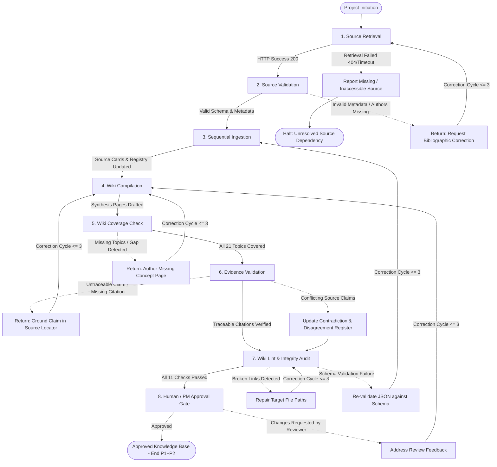

# AI Agents Learning Wiki: Workflow Orchestration Graph

## Purpose
This document specifies the end-to-end execution graph for constructing, maintaining, and verifying the **AI Agents Learning Wiki** across Phases P1 and P2. In adherence to Karpathy's LLM Wiki methodology and robust software engineering principles, the workflow is structured as a **Stateful Directed Graph** with explicit local correction loops, bounded retries (maximum 3 cycles per stage), and human-in-the-loop review gates.

---

## Mermaid Workflow Diagram

---

## Detailed Node Specifications

### Node 1: Source Retrieval
- **Function:** Fetch canonical source documents (ArXiv papers, vendor engineering guides, official framework documentation).
- **Inputs:** List of approved source URLs (`S01` through `S08`).
- **Success Criteria:** HTTP 200 OK, full text/HTML payload retrieved and decoded.
- **Failure Route:** If a URL fails (404, 500, timeout, paywall):
  - Do NOT hallucinate source contents.
  - Record the incident in the ingestion report as "Failed / Inaccessible".
  - Halt automated ingestion for that source dependency.

### Node 2: Source Validation
- **Function:** Verify bibliographic integrity against `schemas/source.schema.json`.
- **Inputs:** Raw fetched content.
- **Verification Elements:** Original title, authors, publisher/venue, publication date, verified section headings, and copyright notice.
- **Return Path:** If metadata is incomplete or invalid, trigger a bibliographic correction pass (bounded to 3 iterations).

### Node 3: Sequential Ingestion
- **Function:** Ingest sources one by one into Layer A (`raw/`).
- **Outputs:**
  - `raw/sources.json` updated.
  - `raw/source-cards/<ID>-<slug>.json` and `.md` generated.
  - Append entry to `wiki/log.md`.
  - Update `wiki/index.md` source registry table.

### Node 4: Wiki Compilation
- **Function:** Synthesize concepts into Layer B markdown pages (`wiki/fundamentals/`, `wiki/architecture/`, `wiki/concepts/`, `wiki/frameworks/`, `wiki/implementation/`, `wiki/safety/`).
- **Style Rules:** Clear academic English, beginner-friendly pedagogy, bold technical terms, mermaid diagrams, and structured comparative tables.

### Node 5: Wiki Coverage Check
- **Function:** Audit the generated knowledge base against the 21 required curriculum topics (Overview, Chatbot vs. Agent, LLM Foundations, Architecture, ReAct, Graph Orchestration, Memory, Tools, CrewAI, LangGraph, OpenAI Agents SDK, MS Agent Framework with AutoGen, etc.).
- **Return Path:** If any topic is unaddressed, return to Node 4 to draft the missing module.

### Node 6: Evidence & Citation Validation
- **Function:** Audit claim-level traceability.
- **Rules:**
  - Every non-trivial factual statement must cite a valid source identifier and locator (`[S01, Section 2]`).
  - Check that all claim citations map to entries in `raw/claims.json`.
  - If two sources assert conflicting definitions (e.g., Anthropic's strict agent/workflow dichotomy vs. LangGraph's unified state graph), trigger the **Contradiction Sub-Routine**: record both positions explicitly in `wiki/evidence-registry.md`.

### Node 7: Wiki Lint & Automated Integrity Audit
- **Function:** Execute `scripts/lint_wiki.py`.
- **Automated Checks (11 Passes):**
  1. Source schema validity.
  2. Claim schema validity.
  3. Source coverage completeness (S01–S08).
  4. Source URL and HTTP status verification.
  5. Claim-to-source mapping.
  6. Contradiction registration verification.
  7. Markdown file non-emptiness and formatting.
  8. Indexing in `wiki/index.md` (no orphan pages).
  9. Absolute and relative link resolution (no 404 broken links).
  10. Topic coverage completeness.
  11. Inline citation validity.
- **Return Path:** If lint fails, route directly to the responsible module (Node 3, 4, or 6). Bounded by a maximum of 3 correction cycles.

### Node 8: Human / Project Manager Approval Gate
- **Function:** Present verified artifacts, test logs, and ingestion reports to the Project Manager / User.
- **Criteria for Done (P1 + P2):**
  - All 8 sources ingested without fabrication.
  - All 11 lint checks green (exit code 0).
  - All documentation (`AGENTS.md`, `README.md`, reports) complete.
  - Strict phase boundary: **No HTML presentation generated until PM grants approval.**

---

## Local Correction Loops & Bounded Retries

To prevent infinite loops, non-terminating agent cascades, or token exhaustion, the workflow enforces a strict **Bounded Loop Policy**:
1. **Maximum Cycle Count:** Any stage may attempt at most **3 correction cycles** to resolve errors (such as repairing a broken link or reformatting metadata).
2. **Hard Termination:** If an error persists after 3 cycles, execution halts immediately and outputs an exception report to `reports/implementation-log.md` detailing the blocker.
3. **Traceability:** Every loop iteration is timestamped and recorded in `wiki/log.md`.
